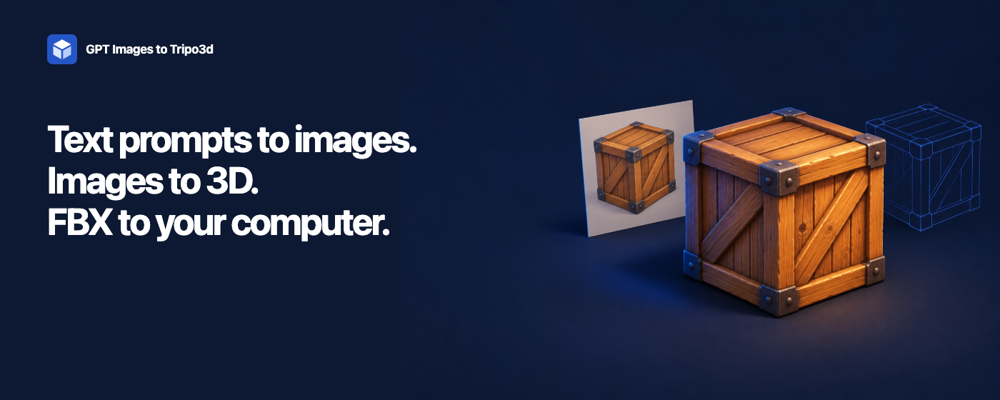

# GPT Images to Tripo3d



Text prompts → images → Tripo 3D → FBX on your computer.

A Chrome extension that sends image prompts through your signed-in ChatGPT tab, processes reference images through your signed-in Tripo Studio tab, and organizes each FBX export with its reference in the folder you choose.

The Tripo model queue runs one image at a time. GPT requests can run concurrently in separate worker tabs. Images in the selected folder’s root are the Tripo queue; subfolders are skipped. Manual browser use needs no API key, Node.js, Python, local server, or native helper. Optional MCP control uses Node.js and a local helper.

## What is ready, and what still needs a first-run check

This version was built against the supplied Tripo Studio HTML listing. That listing includes the image uploader, Generate button, model links, and Export button. It does **not** include the export dialog or the page while a generation is in progress. The complete workflow has not been validated against a live, signed-in Tripo Studio session.

The extension checks the page before acting and pauses when it cannot establish the next step. Start with **Models this run = 1** to check your Studio version, export dialog, and resulting FBX before running a larger batch. If automatic export cannot finish, the recovery controls let you use the existing model or its downloaded FBX/ZIP without generating it again.

Local verification loaded the actual unpacked extension in Chrome 131, used the supplied page listing with simulated generation and export actions, and processed two images sequentially. That run checked FBX format selection, blob transfer, native ZIP decompression, texture paths, browser filesystem writes, copied-image verification, removal of the processed root images, the one-model run limit, and the absence of duplicate browser downloads. The browser check used temporary origin-private storage; selecting a physical SD card and a live Studio export still need the first-run check above.

Additional controlled checks covered interrupted file commits, a lost Generate acknowledgement, stale dashboard state, changed source/model identities, malformed archives, and concurrent recovery actions. No real Studio generation was submitted during verification.

## Install

1. Use desktop **Google Chrome 120 or newer**.
2. Extract the extension ZIP to a folder you will keep on your computer.
3. Open `chrome://extensions` in Chrome.
4. Enable **Developer mode**.
5. Click **Load unpacked** and select the extracted folder containing `manifest.json`.
6. Open Tripo Studio, sign in, and refresh its tab so the extension’s scripts are loaded. Refresh an existing Studio tab after installing or reloading the extension, too.
7. Click the **GPT Images to Tripo3d** extension icon to open its control tab. You can pin the icon using Chrome’s Extensions menu.

Keep the extracted extension folder in place while it is installed. After replacing extension files with an updated version, use **Reload** on `chrome://extensions` and refresh the Studio tab.

## Prepare your images and Studio settings

Create a folder on your SD card or computer and place the input images directly inside it. Supported inputs are `.png`, `.jpg`, `.jpeg`, and `.webp`, with a maximum size of **20 MiB per image**. Empty files are rejected.

Each image file produces **one model**. An orthographic sheet containing several views can be one input image. Separate front, side, and rear image files would be treated as three independent jobs; this version does not group separate views into a multi-image input.

In Studio, select the model version and generation options you want. The extension uses those settings; the credit ceiling does not change model quality, texture settings, or the Studio price. Before each Generate click the queue also reads the credit balance shown in the Studio header; if the balance is below the Generate cost, the run pauses with the job still uploaded. Add credits, then resume. If the balance is not visible, only the ceiling check applies. Keep the selected Studio tab dedicated to this batch while it runs so the selected reference and model remain consistent.

## Run a batch

1. Click **Choose folder** in the control tab. Select your input folder and grant read/write access. If Chrome later asks for access again, use **Reconnect folder**.
2. Select your signed-in tab under **Studio tab**. Use **Refresh tabs** if it is missing, or **Open Studio** to open Studio.
3. Set **Credit ceiling / model**. Its default is **55**, matching the supplied page. The extension checks the displayed Generate cost before clicking and stops if it cannot read the cost or the cost exceeds your ceiling. Discounted prices use the current charge, including free (0-credit) generations; crossed-out prices are ignored. An unreadable or ambiguous charge pauses the queue. This is a per-model ceiling, not a total batch budget.
4. Leave **Models this run** at **1** for the first run.
5. Click **Start batch**. Wait for the model to generate, export, and appear in its output folder. Check the FBX in your usual model viewer or game pipeline.
6. For a larger batch, choose a model count or set **Models this run = 0** for no count limit, then start again.

**Watch for new root images while running** keeps checking for newly added images while the run remains active. With no count limit, it can continue waiting after the current queue is empty. With a positive model limit, reaching that limit ends the run. Turn watch mode off if you want the run to finish when the current queue is empty.

Use **Stop after this model** to stop after the active model has finished and been saved. The control tab, Studio tab, SD card, and computer need to remain available during the run. You can use other tabs. If Chrome or the computer closes, use the recovery controls when you return.

## Folder layout

For a direct FBX export, a root input named `oak_crate.png` becomes these two files:

| File | Location relative to your selected folder |
|---|---|
| Original reference image | `oak_crate/oak_crate.png` |
| Exported model | `oak_crate/oak_crate.fbx` |

A second image, `stone_wall.webp`, becomes `stone_wall/stone_wall.webp` and `stone_wall/stone_wall.fbx`. The original root images disappear only after the export and copied reference have been verified. A newly added root image stays in the queue until its own job finishes.

When Studio provides a ZIP export, the extension extracts the FBX and companion files into the model’s output folder. It preserves filenames and relative paths between model files and textures; a shared outer archive folder is removed. The exported FBX may therefore keep Studio’s name or be inside an archive subfolder instead of being renamed to the reference stem. If an archive path would collide with the reference image or recovery marker, the export files are placed under `model/` inside the output folder.

Existing output folders are not reused for a new job. Name collisions receive a suffix such as `oak_crate--2`. The extension also creates `.tripo-runner` in the selected root to record progress and temporarily stage exports. Keep that folder if you want interrupted jobs to remain recoverable. A temporary ownership marker may be present in an output folder until its commit finishes.

## Interrupted jobs and recovery

The source image stays in the root while a generation or export is pending. Before removing it, the extension validates the export, writes and verifies the output files, copies the reference image, and verifies that the copied image matches the original. A changed input image or conflicting output file stops the job instead of overwriting it.

The extension records the intent to generate before clicking Generate. If an interruption makes the result uncertain, it does **not** automatically submit another generation. The recovery panel provides three ways to continue:

| Control | Use it when |
|---|---|
| **Resume job** | The saved Studio generation or staged export can be resumed. If the job had not reached generation, it can continue its preparation. |
| **Use selected model** | Open the correct existing model for this reference in the selected Studio tab, then use this button to associate it with the waiting job and export it. Check the selected model carefully. |
| **Use downloaded FBX/ZIP** | Export the correct existing model manually in Studio, then select that downloaded `.fbx` or `.zip` file. The extension validates and saves it with the reference image. |

These controls let you finish work that has already been generated. They do not need another Generate click for an existing model. Keep a downloaded ZIP intact when it contains textures; importing only an isolated FBX cannot restore companion files that were not supplied.

If the card is disconnected, reconnect it and restore folder access before resuming. If the extension reports a different file already occupying an output path, inspect that conflict before moving the conflicting file or folder aside and resuming. Do not delete `.tripo-runner` just to clear a waiting job: it contains the record that prevents an uncertain generation from being silently submitted again.

## GPT images tab

The **GPT images** tab appears first and opens by default on a new install. The dashboard remembers your last selected tab. **Folder settings** switches to the folder controls in **Tripo models**.

The **GPT images** tab sends pasted prompts to ChatGPT in a signed-in browser tab and saves each generated image to the root of the folder selected in the **Tripo models** tab. With **Watch for new root images** enabled, a running Tripo queue picks the saved images up.

1. Choose the folder in **Tripo models** first.
2. In **GPT images**, click **Open ChatGPT** (or open `https://chatgpt.com/` yourself), sign in, then click **Refresh tabs**.
3. Paste prompts. A blank line separates prompts; single line breaks stay inside a prompt. Prompts are sent exactly as written, so ask for an image in the prompt itself.
4. Click **Add to queue**, then **Start prompts**.

Each prompt runs in a new chat in the selected tab. The first image of the reply is saved as `<prompt start>.png` (or `.jpg`/`.webp`, depending on what ChatGPT returns). Existing names get a `--2` suffix. The queue is stored in the extension and survives closing the control tab.

A prompt is recorded as sent before the send button is clicked. After an interruption, **Start prompts** reopens the recorded chat and checks it for the image; it does not send the prompt again. **Send again** in a row is the only action that resends a prompt. A reply without an image marks that prompt failed and the queue continues. A usage-limit message, a signed-out tab or a 12-minute wait without an image pauses the queue. Temporary status-check failures get up to five attempts, with 2, 4, 8 and 16-second backoff delays inside the same 12-minute deadline. A successful check resets that retry budget. Retries only check the existing chat; they never resend the prompt. Image-free completion requires an explicit completed response, no pending image, and 60 seconds of stability. Unknown completion keeps waiting. Limits and interruptions preserve the submitted prompt so Start checks its recorded chat.

The ChatGPT page markup is not a stable API. If ChatGPT changes its layout, prompts may fail to send or images may not be detected; the queue pauses instead of resending.

## Queue status tabs

Both queues: **All**, **Waiting**, **Active**, **Needs attention**, **Completed** (GPT: **Saved**). Counts cover all records. Folder queue displays latest 80 completed models; earlier output stays on disk. Arrow keys, Home, End switch status tabs. Filters change display only.

## Local MCP control

Optional. Node.js 20+. Local MCP client with stdio support: Claude, Codex, or another compatible client. No package install required. Supports initialize-based MCP versions `2025-06-18`, `2025-03-26`, `2024-11-05`.

One-time setup:

1. Install from Chrome Web Store or load unpacked. Open MCP dropdown → One-time setup. Download the matching bundled helper and extract into a permanent `mcp-helper` folder. Node.js 20+ required; no Python or package install needed. Keep extracted files together.
2. Create output directory. Use absolute path; symlink directory rejected.
3. Copy **Claude config** (JSON) or **Codex config** (TOML) from dropdown. Actual extension ID included. Set helper path to extracted `mcp-helper/mcp/server.js` and set output path, then add template to client. Claude example:

```json
{
  "mcpServers": {
    "folder-runner": {
      "command": "node",
      "args": ["/absolute/path/to/mcp-helper/mcp/server.js"],
      "env": {
        "RUNNER_EXTENSION_ID": "your_32_character_extension_id",
        "RUNNER_OUTPUT_DIR": "/absolute/path/to/output"
      }
    }
  }
}
```

Codex example:

```toml
[mcp_servers.image-runner]
command = "node"
args = ["/absolute/path/to/mcp-helper/mcp/server.js"]

[mcp_servers.image-runner.env]
RUNNER_EXTENSION_ID = "your_extension_id"
RUNNER_OUTPUT_DIR = "/absolute/path/to/output"
```

Use absolute Node executable path if client cannot find `node`. Existing output directory required. Node helper reads/writes only that directory; subdirectory symlinks rejected. Existing manual folder picker remains available when no configured directory supplied.

Keep **Allow agent control** enabled in MCP dropdown. It remembers your choice. Off disconnects agent control; current image/model work continues. Status shows **Waiting for local helper**, **Local helper connected**, or **Agent control off**. Helper connection does not prove an active model session.

Use one control dashboard. Additional control tabs cannot write GPT state or claim helper session; they show **Agent control unavailable**. Request worker tabs stay separate from control dashboard.

Keep Chrome running with extension enabled. Background discovery checks helper on default port `17321` every 30 seconds. It opens control tab automatically; existing control tab connects automatically. No folder picker, token copy, or queue button required. Initial Chrome installation, extension reload after updates, and service sign-in still need browser access. Keep control tab open during runs.

GPT-only workflow needs no Tripo tab: ask agent to open ChatGPT with `runner_open_tab`, add prompts, then start GPT queue. Generated images save directly to `RUNNER_OUTPUT_DIR`. For models, open Studio, configure generation options there, then start Tripo queue. Studio generation can spend credits; configured ceiling still applies.

Multiple agents/chats use same MCP configuration. One shared helper routes each client's replies; one dashboard coordinates workers. Extension ID, output directory and explicit token settings must match. Closing one client leaves other clients and connected dashboard available. Accepted work may continue after client disconnect or timeout. Each GPT request uses its own browser tab. Different requests generate concurrently; prompts within one request run serially, each in its own ChatGPT conversation.

For separate requests, generate a unique `requestId` per batch. Keep it unchanged across retries:

```json
{"name":"runner_add_prompts","arguments":{"requestId":"agent-a-chat-42-batch-1","prompts":["Generate an image of a sparrow"]}}
```

Start the batch with `runner_start` using `queue: "gpt"` and the same `requestId`, then call `runner_status` with that ID. GPT results include matching prompt records, saved filenames and conversation links. Stop only that batch with `runner_stop` using `queue: "gpt"` and its `requestId`. Same request ID plus exact original prompts returns original IDs; changed prompts reject. Receipts survive clearing/removing records. Request IDs label work; they do not authenticate agents. Output folder, Tripo queue and Studio settings stay shared. Coordinate global controls between agents.

Dashboard **Start prompts** starts all ready batches. Dashboard Stop stops all GPT workers after current images. MCP start without `requestId` starts only manual/unscoped prompts. Resuming a request reopens its recorded chat; a closed worker tab gets a replacement tab.

Tools:

| Tool | Action |
|---|---|
| `runner_status` | Queue state, folder, settings, available tabs. Optional `requestId` filters GPT before pagination; Tripo stays shared. `offset` and `limit` default 0/25, max limit 50. |
| `runner_open_tab` / `runner_select_tab` | Open fixed ChatGPT/Studio URL or select existing tab. |
| `runner_add_prompts` | Append exact prompt strings. Optional stable `requestId` prevents duplicate enqueue. No send until start. |
| `runner_start` | Start/resume GPT batch with `requestId`, or legacy GPT/Tripo queue without it. GPT already running reports existing run; inspect stopping state and status. Startup acceptance is not completion. |
| `runner_stop` | With GPT `requestId`, stop that batch after current image. Without it, stop shared queue workers after current work. |
| `runner_rescan` / `runner_settings` | Rescan idle folder; set credit ceiling, model limit, watch. |
| `runner_clear_finished` | Clear saved/failed GPT records; optional `requestId` scopes records. Omitted means all requests. Files and request receipts kept. |
| `runner_prompt_action` | Explicit retry/remove by prompt ID. Optional `requestId` checks matching request. Retry permits another send. |

Interrupted work keeps existing recovery rules. No automatic resend or regeneration. Model binding, manual FBX import, and explicit Tripo regeneration remain browser recovery actions. Timed-out commands are never replayed; inspect status before retry. Only request-keyed enqueue safely deduplicates a deliberate retry. Queue data remains in extension storage and output directory.

Helper binds `127.0.0.1`; stdio clients use private local IPC. Bootstrap accepts only configured extension identity; browser web origins rejected. Per-broker token authenticates extension requests. Optional `RUNNER_MCP_TOKEN` sets token (minimum 32 characters); default generated automatically. Browser discovery uses default port `17321`; leave helper port unchanged. Tokens are exchanged automatically; no token entry or Connect button. Broker stops after clients and dashboard disconnect. No telemetry. Local filesystem writes stream to temporary files; successful close atomically replaces destination; abort preserves prior bytes.

Run automated suite:

```sh
taskpolicy -b nice -n 19 env NODE_OPTIONS=--max-old-space-size=2048 UV_THREADPOOL_SIZE=1 RAYON_NUM_THREADS=1 npm test
```

macOS command shown. Other hosts: supported lowest-priority equivalent. Check CPU, memory, disk, competing builds before tests. Suite uses controlled local HTTP/filesystem fixtures; no live ChatGPT prompt or Tripo generation.

## Release packaging

Developer build only: run `npm run package` (Python 3.9+), or `python3 scripts/package-release.py`. Manifest, package, dashboard version label, and helper download filename must match. Script creates `assets/mcp-helper.zip`, `store/gpt-images-tripo3d-{version}.zip`, and `store/gpt-images-tripo3d-mcp-{version}.zip`. Extension archive includes matching helper download; companion helper archive contains identical bytes. Prior version archives remain unchanged. Current version outputs are replaced atomically.

Use `--output-dir /absolute/path/to/release-check` for isolated outputs under that folder’s `assets/` and `store/`. Archives use explicit runtime allowlists and fixed entry metadata. Helper needs only Node.js 20+ at runtime.

After updating extension, download matching helper. Finish active queue work first. Then stop MCP clients and disconnect agent control before replacing extracted helper files; restart clients and enable agent control afterward.

## Limits

| Item | Limit |
|---|---:|
| Source image | 20 MiB |
| Downloaded or imported export package | 512 MiB |
| Total unpacked ZIP content | 1 GiB |
| One unpacked ZIP entry | 768 MiB |
| Entries in a ZIP | 2,048 |
| Concurrent Tripo generation jobs | 1 |
| Concurrent GPT generation jobs | 1 per active request; separate requests run in parallel |

Exports must contain a recognizable FBX. ZIP validation includes archive paths, entry sizes, and integrity checks. Unsupported or oversized exports pause the job with the input image retained. Large exports need corresponding free space on the selected drive because the original package is staged before the output files are committed.

## Permissions and data

The manifest also permits `http://127.0.0.1/*` for optional local MCP and uses an alarm to discover its helper. HTTPS host access (`https://*/*`) so the control tab can fetch a signed export URL even when Tripo serves it from a separate CDN. The automation scripts are declared only for the Tripo Studio/workspace addresses and `https://chatgpt.com/*` in `manifest.json`. The extension does not inject its scripts into other sites.

The folder picker grants access to the folder you select. The extension reads reference images, writes model folders and recovery records, and removes a root image only after its copy and export have been verified. It uses your existing Studio session and the normal Studio upload/generation/export interface. There is no telemetry or separate analytics service in this extension.

## Platform references

- [Chrome File System Access API](https://developer.chrome.com/docs/capabilities/web-apis/file-system-access): chosen folders, stored handles, permissions, and file writes.
- [Chrome cross-origin network requests](https://developer.chrome.com/docs/extensions/develop/concepts/network-requests): why signed export downloads are fetched from the extension tab with host permission.
- [Chrome extension messaging](https://developer.chrome.com/docs/extensions/develop/concepts/messaging): communication between the Studio scripts and control tab.
- [Chrome extension service-worker lifecycle](https://developer.chrome.com/docs/extensions/develop/concepts/service-workers/lifecycle): why the control tab remains open during the queue.
